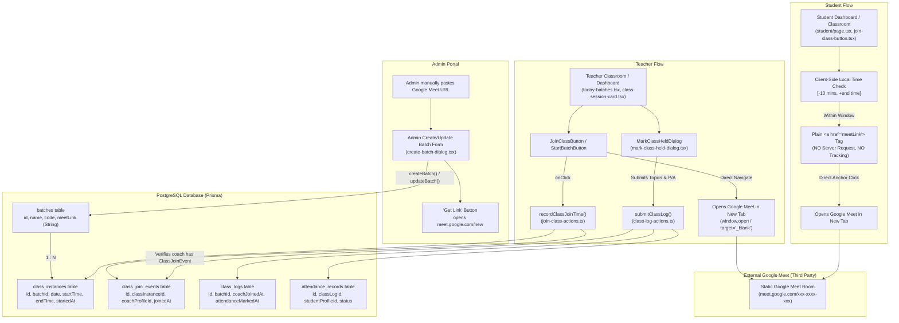
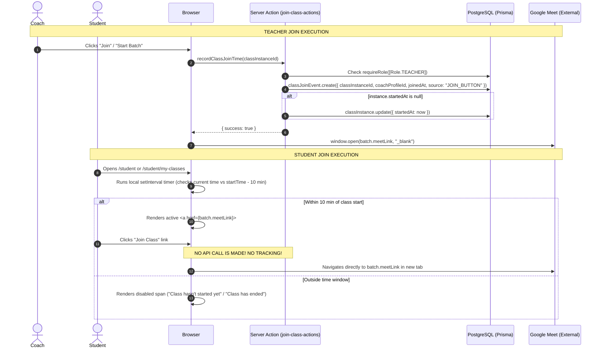
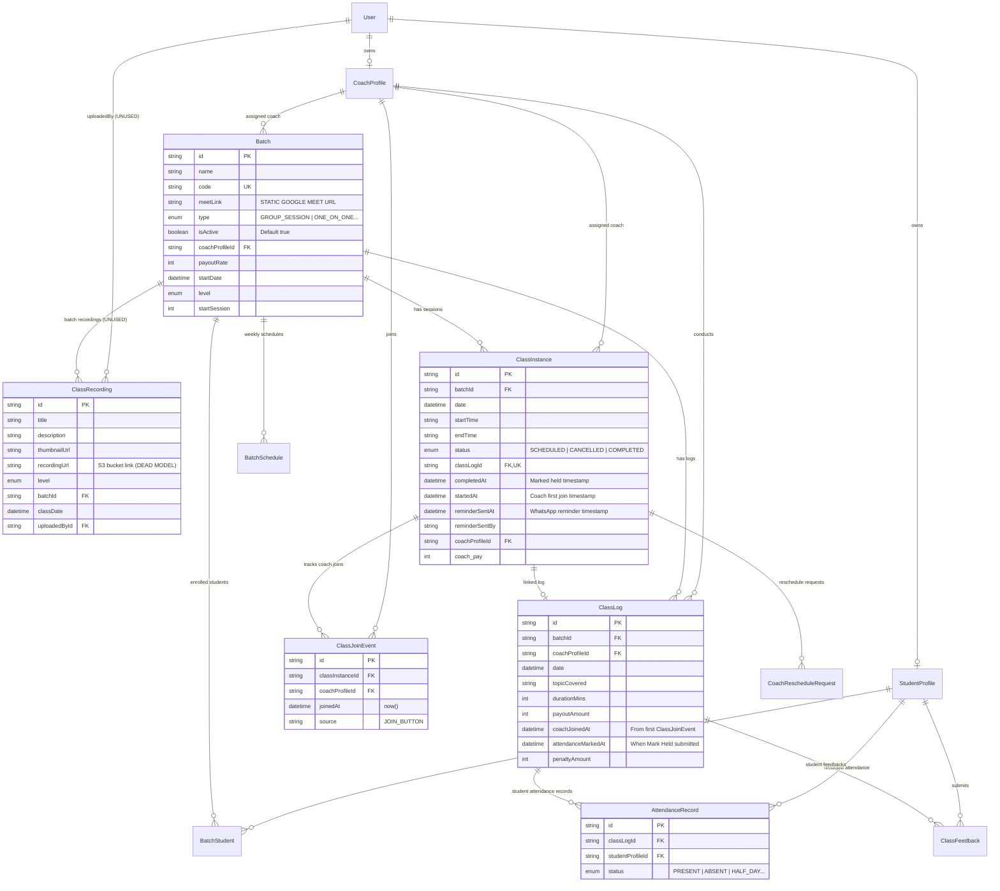

# STRATEGIC MIND CHESS (SMC) — EXISTING MEETING SYSTEM TECHNICAL AUDIT
**Document Reference:** `EXISTING_MEETING_SYSTEM_AUDIT.md`  
**Auditor Role:** Senior Backend Engineer, System Architect & Independent Technical Auditor  
**Date:** November 6, 2026  
**Status:** COMPLETE AUDIT  
**Scope:** Reverse-engineering of existing meeting, attendance, recording, background jobs, and cloud integration architectures.

---

## 1. EXECUTIVE SUMMARY

An exhaustive investigation of the Strategic Mind Chess codebase (`c:\Users\techs\prototype`) reveals that **there is currently NO programmatic Google Meet API, Google Calendar API, or Google Workspace integration whatsoever**.

### Key Architectural Findings:
1. **Manual Link Creation:** The existing meeting system relies entirely on a single static URL string (`meetLink`) stored on the `Batch` database table. This link is manually pasted by an administrator when creating or updating a batch.
2. **Permanent Static Link Per Batch:** The same Google Meet URL is reused across all recurring class sessions (`ClassInstance`) of a batch for its entire lifetime. There is no unique Google Meet room per session.
3. **Teacher Join Mechanism:** When a coach clicks "Join" or "Start Batch", a Server Action (`recordClassJoinTime`) creates an audit log entry (`ClassJoinEvent`) and stamps `ClassInstance.startedAt`. The browser then simply triggers `window.open(meetLink, "_blank")`.
4. **Student Join Mechanism:** For students, the frontend renders a plain HTML anchor tag (`<a href={batch.meetLink}>`). Students are gated by client-side local clock checks (10 minutes prior to start until end of class). **Student clicks trigger zero API requests, zero database changes, and zero tracking.**
5. **Attendance Mechanism:** Attendance is **100% manual**. Coaches submit a form after class (`submitClassLog`). The backend verifies only that the coach recorded a join click (`ClassJoinEvent`), then writes `AttendanceRecord`s based solely on the coach's manual input. There is no Google Meet participant detection.
6. **Recordings and S3:** Although `@aws-sdk/client-s3` is present and active, it is used exclusively for LMS courses, lesson videos, and thumbnail uploads. A Prisma model named `ClassRecording` exists in the schema, but is completely unused in application code. There is **zero meeting recording capture, zero Google Drive recording sync, and zero S3 recording pipeline**.
7. **No Meeting Logs:** The file `meet.log` does **not exist**. Logging is handled via Pino to `app.log` and `worker.log`, neither of which tracks Google Meet telemetry.

---

## 2. EXISTING TECHNOLOGY STACK

| Layer | Technologies / Packages | Purpose & Evidence |
| :--- | :--- | :--- |
| **Frontend Framework** | Next.js 16.2.10, React 19.2.4 | App Router (`src/app`), Server Components, Client Components (`'use client'`) |
| **Styling & Icons** | Tailwind CSS 4, Lucide React (`lucide-react`) | Responsive UI, dashboards, action buttons |
| **State & Data Fetching** | SWR 2.5.1, React Hook Form, Server Actions | Client-side polling and mutations (`src/actions/*`) |
| **Backend Runtime** | Node.js v22.15.0 (Server Actions & Route Handlers) | Server-side execution in Next.js App Router |
| **Database & ORM** | PostgreSQL, Prisma ORM 7.8.0, `@prisma/adapter-pg` | Multi-file schema in `prisma/schema/*.prisma`, custom client output |
| **Authentication** | JWT (`jose`), `bcryptjs`, HttpOnly Cookies | Stateless session cookies; Refresh tokens and OTP codes in DB |
| **Identity & SSO** | Google OAuth 2.0 (Custom fetch implementation) | Single Sign-On only (`src/services/auth/google-oauth.ts`); scopes: `openid email profile` |
| **Queue & Workers** | BullMQ 5.8.0, ioredis 5.4.1, PM2 | Standalone worker daemon (`worker.ts`, `ecosystem.config.js`) |
| **Object Storage** | AWS S3 SDK v3 (`@aws-sdk/client-s3`, presigner) | Course LMS video uploads (`src/lib/s3.ts`, `src/actions/courses/*`) |
| **External Messaging** | Meta WhatsApp Cloud API | Utility class reminder templates (`src/services/whatsapp/*`) |
| **Logging** | Pino 9.14.0, Pino-pretty | Structured JSON logging (`src/lib/logger.ts`, `src/lib/api-logger.ts`) |

---

## 3. ARCHITECTURE OVERVIEW

The following diagram illustrates the actual, verified architecture of the existing meeting system:



---

## 4. FRONTEND EXECUTION FLOW

### 4.1 Teacher Execution Flow
1. **Teacher Dashboard (`/teacher`) & Batches (`/teacher/batches`):**
   - File: `src/app/teacher/today-batches.tsx` and `src/components/dashboard/class-session-card.tsx`.
   - The server queries `prisma.classInstance` for today's scheduled classes belonging to the coach.
   - For each class, it pulls `instance.batch.meetLink`.
2. **Component Rendering:**
   - On `/teacher`: Renders `JoinClassButton` (`src/app/teacher/join-class-button.tsx`).
   - On `/teacher/batches`: Renders `ClassSessionCard` containing `StartBatchButton` (`src/components/coach/start-batch-button.tsx`).
3. **Click Execution:**
   - Teacher clicks the button.
   - In `JoinClassButton`:
     ```typescript
     // src/app/teacher/join-class-button.tsx
     const handleClick = () => {
       if (!clicked) {
         setClicked(true);
         recordClassJoinTime(classInstanceId).catch(console.error);
       }
     };
     ```
   - In `StartBatchButton`:
     ```typescript
     // src/components/coach/start-batch-button.tsx
     setIsLoading(true);
     try {
       await recordClassJoinTime(classInstanceId);
     } finally {
       setIsLoading(false);
       if (meetLink) window.open(meetLink, "_blank");
     }
     ```
   - **Network action:** Invokes the Next.js Server Action `recordClassJoinTime(classInstanceId)`.
   - **Navigation:** The Google Meet URL is opened in a new browser tab.

### 4.2 Student Execution Flow
1. **Student Dashboard (`/student`) & Classroom (`/student/my-classes`):**
   - File: `src/app/student/page.tsx` and `src/components/student/join-class-button.tsx`.
   - Queries `classInstance` where `batch.students` includes the student's profile and `batch.isActive = true`.
2. **Client-Side Gating Logic:**
   - File: `src/components/student/join-class-button.tsx` (Lines 27–63):
     ```typescript
     const [startH, startM] = nextInstance.startTime.split(":").map(Number);
     const [endH, endM] = nextInstance.endTime.split(":").map(Number);
     const classStart = new Date(now);
     classStart.setHours(startH, startM, 0, 0);
     const classEnd = new Date(now);
     classEnd.setHours(endH, endM, 0, 0);
     const joinWindowStart = new Date(classStart.getTime() - 10 * 60 * 1000);

     if (now < joinWindowStart) {
       setIsActive(false); // "Class hasn't started yet"
     } else if (now > classEnd) {
       setIsActive(false); // "Class has ended"
     } else {
       setIsActive(true);  // Button enabled
     }
     ```
3. **Click Execution:**
   - If active, the student sees:
     ```tsx
     <a href={meetLink} target="_blank" rel="noreferrer" className="...">
       Join Class <ExternalLink className="h-3.5 w-3.5" />
     </a>
     ```
   - **Crucial Auditor Finding:** There is **NO `onClick` handler**, **NO Server Action**, and **NO API request**. The browser directly navigates to the external Meet link. SMC backend receives **zero notification** that a student joined.



---

## 5. BACKEND EXECUTION FLOW & ENDPOINTS

### 5.1 Meeting-Related Endpoints & Server Actions Inventory

| Operation | Type | Route / Function | Auth / Role | Input Parameters | Database Operations | External Calls |
| :--- | :--- | :--- | :--- | :--- | :--- | :--- |
| **Create Batch & Meet Link** | Server Action | `createBatch` in `src/actions/batch-actions.ts` | `requireRole(['ADMIN'])` | `name, code, meetLink, payoutRate, schedules, startDate, type` | `prisma.batch.create`, `prisma.batchSchedule.createMany`, calls `generateInstancesInternal` | None |
| **Update Batch Meet Link** | Server Action | `updateBatch` in `src/actions/batch-actions.ts` | `getCurrentUser() (Role === 'ADMIN')` | `batchId, name, code, meetLink, coachId, studentIds, payoutRate` | `prisma.batch.update`, syncs students, enqueues resync job if syllabus changed | None |
| **Teacher Click Join** | Server Action | `recordClassJoinTime` in `src/actions/join-class-actions.ts` | `requireRole([Role.TEACHER])` | `classInstanceId: string` | `$transaction`: `classJoinEvent.create`, updates `classInstance.startedAt` (if null) | None |
| **Mark Attendance / Class Held** | Server Action | `submitClassLog` in `src/actions/class-log-actions.ts` | `requireRole([Role.TEACHER])` | `classInstanceId, topicCovered, durationMins, attendance[]` | Validates `classJoinEvent.findFirst`. In `$tx`: `classLog.create`, `classInstance.update(COMPLETED)`, `attendanceRecord.createMany` | None |
| **WhatsApp Meet Link Reminder** | Server Action | `notifyClassStudentsAction` in `src/actions/class-reminder-actions.ts` | `requireRole(['ADMIN', 'TEACHER'])` | `classInstanceId, targetStudentIds[]` | Queries `classInstance` + `batch.meetLink`. Updates `reminderSentAt, reminderSentBy` | Meta Cloud API (`sendWhatsAppMessage`) |
| **Teacher Reschedule Request** | API Route (POST) | `/api/teacher/reschedule-requests` | `requireRole([Role.TEACHER])` | `classInstanceId, reason, proposedDate, proposedStartTime, proposedEndTime` | `prisma.coachRescheduleRequest.create` | None |
| **Admin Review Reschedule** | API Route (POST) | `/api/admin/reschedule-requests/[id]/review` | `requireRole([Role.ADMIN])` | `action, penaltyAmount, replacementCoachId, applyReschedule` | `prisma.coachRescheduleRequest.update`. If approved, updates `classInstance.date/startTime/endTime` | None |
| **Student My Classes** | API Route (GET) | `/api/student/my-classes` | `requireRole([Role.STUDENT])` | None (reads cookie session) | Queries `classInstance` where `batch.students` has student and `batch.isActive = true` | None |

### 5.2 External API Verification
- **Google Meet REST API (`meet.googleapis.com`):** NOT IMPLEMENTED.
- **Google Calendar API (`calendar.googleapis.com`):** NOT IMPLEMENTED.
- **Google Workspace Events API:** NOT IMPLEMENTED.
- **Google Drive Video Processing API:** NOT IMPLEMENTED.
- **Google Pub/Sub Subscriptions:** NOT IMPLEMENTED.
- **Google Meet Webhooks:** NOT IMPLEMENTED.

The backend **only** communicates externally with:
1. Google OAuth token verification (`https://oauth2.googleapis.com/token`) solely during user login/SSO.
2. Meta WhatsApp Cloud API (`https://graph.facebook.com/v...`) for class reminders.
3. Chess.com Public API and Lichess.org Public API for leaderboard statistics.
4. S3 storage API for course video uploads.

---

## 6. DATABASE DEEP INVESTIGATION

The database is PostgreSQL managed by Prisma ORM (`prisma/schema/*.prisma`).

### 6.1 Meeting-Related Models & Relationships



### 6.2 Key Database Observations
1. **`Batch.meetLink`:** The only location where a meeting URL is stored. There is no `meetLink` or `meetUrl` column on `ClassInstance`.
2. **`ClassInstance.startedAt`:** Nullable `DateTime`. Populated only when the coach clicks "Join" or "Start Batch". It serves as `coachJoinedAt` for penalty calculations (e.g., late-join penalty engine).
3. **`ClassJoinEvent`:** Has indexes `@@index([classInstanceId, coachProfileId, joinedAt])`, `@@index([classInstanceId])`, and `@@index([coachProfileId])`. Records coach clicks. There is no `studentProfileId` on this table — student joins are completely untracked.
4. **`ClassRecording`:** Defined in `prisma/schema/training.prisma` (lines 55–69). Contains `recordingUrl String`, `batchId String?`, `uploadedById String`. **Audit finding:** Zero rows are created in application code; it has no queries anywhere in `src/`.

---

## 7. MEETING LIFECYCLE AUDIT

| Stage | Triggered By | API / Server Action | Database Changes | Third-Party Calls | Status in Code |
| :--- | :--- | :--- | :--- | :--- | :--- |
| **1. Meeting Creation** | Admin in UI | `createBatch` / `updateBatch` | Creates `Batch` row with text `meetLink` | None (Admin opens `meet.google.com/new` manually) | **MANUAL STRING ENTRY** |
| **2. URL Persistence** | Admin submission | Server Action | Saved in `batches.meetLink` | None | **IMPLEMENTED (Static)** |
| **3. Teacher Joining** | Coach clicks Join | `recordClassJoinTime` | Inserts `ClassJoinEvent`, sets `ClassInstance.startedAt` | `window.open(meetLink)` in client browser | **PARTIALLY IMPLEMENTED (Click tracked only)** |
| **4. Student Joining** | Student clicks Join | Direct anchor tag (`<a href>`) | **None** | Browser opens URL | **CLIENT ANCHOR ONLY (No backend trace)** |
| **5. Conference Starting** | First user enters Meet | Google Meet server | **None** | Handled entirely by Google | **UNTRACKED BY SMC** |
| **6. Participant Tracking** | Participants enter/leave | None | **None** | None | **NOT IMPLEMENTED** |
| **7. Attendance Recording** | Coach submits form | `submitClassLog` | Creates `ClassLog`, `AttendanceRecord`s, sets `ClassInstance.status = 'COMPLETED'` | None | **MANUAL COACH FORM (Checks coach join event)** |
| **8. Recording Creation** | None | None | None | None | **NOT IMPLEMENTED** |
| **9. Recording Storage** | None | None | None | None | **NOT IMPLEMENTED** |
| **10. Meeting Ending** | Participants leave Meet | Google Meet server | **None** | None | **UNTRACKED BY SMC** |
| **11. Meeting Cleanup / Archive**| Admin toggles `isActive` | `setBatchActiveState` | Updates `Batch.isActive = false` | None | **DB FLAG ONLY (Meet link untouched)** |

---

## 8. ATTENDANCE INVESTIGATION

### 8.1 How Attendance Works Today
- Attendance is **independent of Google Meet participant data**.
- After a class finishes (validated by checking if current IST time > `instance.endTime`), the coach visits `/teacher/attendance`.
- The coach opens `MarkClassHeldDialog` (`src/components/coach/mark-class-held-dialog.tsx`).
- The coach enters `topicCovered`, `durationMins`, and selects `PRESENT` or `ABSENT` for each student.
- On submission, `submitClassLog` executes:
  1. Verifies coach role (`Role.TEACHER`).
  2. Queries `ClassJoinEvent.findFirst` for that `classInstanceId` and `coachProfileId`. If missing, the request is rejected with:
     `"Coach must join the class before marking attendance"`.
  3. Inserts `classLog` and bulk-inserts `attendanceRecord`s.
  4. Updates `classInstance.status = 'COMPLETED'`.

### 8.2 Attendance Limitations
- **No Participant Verification:** A coach can click "Join" on the portal to satisfy the `ClassJoinEvent` check, never actually attend the Google Meet, and mark all students Present.
- **No Student Timestamp Capture:** Join/leave timestamps, duration in meeting, late arrival, or early departure of students are **completely unknown** to the platform.
- **Duplicate Attendance Prevention:** Enforced by DB constraint `@@unique([classLogId, studentProfileId])` and check `if (classInstance.status === "COMPLETED") return error`.

---

## 9. RECORDING AND AWS S3 INVESTIGATION

### 9.1 S3 Infrastructure Audit
- Configuration file: `src/lib/s3.ts`.
- Uses `@aws-sdk/client-s3` and `@aws-sdk/s3-request-presigner`.
- S3 Client Initialization:
  - `endpoint`: `process.env.S3_ENDPOINT_URL` (default: `https://t3.storageapi.dev`)
  - `region`: `process.env.S3_REGION` (default: `auto`)
  - `bucket`: `process.env.S3_BUCKET_NAME` (default: `convenient-briefcase-lioy-2`)
  - Credentials: `S3_ACCESS_KEY_ID`, `S3_SECRET_ACCESS_KEY`.
- Actual usage across codebase:
  1. `src/actions/courses/course-actions.ts`: Presigned upload URLs for Course thumbnails (`thumbnails/...`).
  2. `src/actions/courses/lesson-actions.ts`: Multipart chunked presigned upload URLs for LMS course video lessons (`courses/{courseId}/lessons/{lessonId}/video/...`).
  3. `src/app/api/upload/route.ts`: Generic file upload route.
  4. `src/actions/s3-actions.ts`: Folder listing and download presigner.

### 9.2 Meeting Recordings Status
- **Google Meet recording ingestion:** **0% IMPLEMENTED**.
- **Google Drive ingestion:** **0% IMPLEMENTED**.
- **`ClassRecording` model:** Dormant database table with zero read/write operations.
- Meeting sessions are **never recorded, never transferred, and never made available on the website**.

---

## 10. LOGGING AND ERROR HANDLING

### 10.1 Logging Architecture
- Central logger: `src/lib/logger.ts` using **Pino**.
- API logging middleware: `src/lib/api-logger.ts` (`withLogging` wrapper for route handlers, logging request ID, route, memory delta, status code).
- Existing Log Files in `c:\Users\techs\prototype\logs`:
  1. `app.log` (962 KB): General application runtime logs.
  2. `worker.log` (81 KB): BullMQ worker processing logs and WhatsApp dispatch telemetry.
  3. `webhook.log` (36 KB): Incoming Meta WhatsApp webhook payloads.
  4. `smc.log` (0 B): Empty file.
- **`meet.log` status:** **DOES NOT EXIST**. There is no log file or logger configuration for Google Meet.

---

## 11. BACKGROUND WORKERS AND CRON JOBS

The application runs a separate persistent worker process via `worker.ts` (managed by PM2 using `ecosystem.config.js`).

### 11.1 BullMQ Queues and Workers
1. `batch-queue` (`src/workers/batch.worker.ts`):
   - Job: `sync-future-instances`.
   - Action: Cleans up future scheduled instances and re-generates class instances when batch level or start session changes.
2. `chess-fetch-queue` (`src/workers/chess-fetch.worker.ts`):
   - Fetches activity from Chess.com and Lichess.org for students.
3. `leaderboard-calc-queue` (`src/workers/leaderboard-calc.worker.ts`):
   - Computes weekly and monthly leaderboard scores.
4. `log-cleanup-queue` (`src/workers/log-cleanup.worker.ts`):
   - Cleans logs older than 30 days.
5. `attendance-summary-queue` (`src/workers/attendance-summary.worker.ts`):
   - Calculates monthly student attendance percentages from `attendance_records`.
6. `assignment-summary-queue` (`src/workers/assignment-summary.worker.ts`):
   - Computes student homework completion percentages.
7. `penalty-queue` (`src/workers/penalty.worker.ts`):
   - Runs daily at 02:00 UTC. Evaluates feedback and late-join penalties against coach class logs.
8. `whatsapp-queue` (`src/workers/whatsapp.worker.ts`):
   - Processes asynchronous WhatsApp notification batches.

**Audit Finding:** **Zero** workers or queues are associated with Google Meet, conference management, video recordings, or meeting attendance detection.

---

## 12. SECURITY & ACCESS CONTROL AUDIT

| Area | Security Posture | Evidence & Risk | Severity |
| :--- | :--- | :--- | :--- |
| **Meeting URL Exposure** | Insecure | The Google Meet URL is a static string sent in plaintext SSR HTML to anyone enrolled in the batch. | **HIGH** |
| **Unauthorized Student Access**| Insecure | The meeting link is static. A student who leaves the academy or is suspended can still join the Meet call if they bookmark or share the URL. | **HIGH** |
| **Zero Student Join Verification**| Insecure | Student join link is an unauthenticated `<a href>`. Backend cannot distinguish whether a student clicked or never showed up. | **HIGH** |
| **Coach Join Spoofing** | Vulnerable | Coach join is tracked via a simple server action call `recordClassJoinTime()`. Anyone calling that action marks the coach as joined without entering Google Meet. | **MEDIUM** |
| **Google Meet Host Ownership** | Uncontrolled | Because Google Meet links are generated manually from personal or ad-hoc Google accounts (`meet.google.com/new`), Strategic Mind Chess does not centrally own or govern the rooms. | **CRITICAL** |
| **Minors Privacy & Recording** | Not Compliant | No recording consent disclaimer or privacy notice exists anywhere in the classroom or dashboard flows. | **HIGH** |

---

## 13. TEST COVERAGE

Automated tests in `c:\Users\techs\prototype\tests`:
- `admin-penalty-api.test.ts`
- `attendance-timezone-flow.test.ts`
- `class-feedback-api.test.ts`
- `class-feedback-pending-api.test.ts`
- `integration-penalty-flow.test.ts`
- `penalty-demo-missed-class.test.ts`
- `penalty-engine.test.ts`
- `penalty-worker-consensus.test.ts`
- `penalty-worker.test.ts`

**Audit Finding:**
- Total tests for Meeting URL generation: **0**
- Total tests for Meeting Join flow: **0**
- Total tests for `ClassJoinEvent`: **0**
- Total tests for Google Meet / Calendar / Video APIs: **0**
- **Test coverage for the meeting system is 0.00%.**

---

## 14. GAP ANALYSIS: CURRENT IMPLEMENTATION VS. MONTH 2 WEEK 2 REQUIREMENTS

| Month 2 Week 2 Requirement | Current Status | Detailed Gap in Codebase |
| :--- | :--- | :--- |
| **Start class from website with unique room** | **NOT IMPLEMENTED** | Current implementation uses a single static URL on `Batch`. No dynamic Meet room is created per class session. |
| **Join class button activated shortly before class** | **PARTIALLY IMPLEMENTED** | Student button has a 10-minute client-side timer in React state, but triggers no backend action or session validation. |
| **Unique Meet link per class / session** | **NOT IMPLEMENTED** | `ClassInstance` model does not have a `meet_link` column. All sessions inherit `batch.meetLink`. |
| **Automatic Google Meet Recording** | **NOT IMPLEMENTED** | No Google Workspace API, no Drive integration, no recording webhooks or polling. |
| **Recordings linked to class record in website** | **NOT IMPLEMENTED** | `ClassRecording` model is dormant; no UI exists to watch or browse class session recordings. |
| **Click tracking (User, Class, Time, Role)** | **PARTIALLY IMPLEMENTED** | Coach click creates `ClassJoinEvent`. Student click is completely untracked (raw anchor tag). |
| **Attendance support from Start/Join & Participants**| **NOT IMPLEMENTED** | Attendance is 100% manual. No participant data is ingested from Google Meet. |
| **Google Calendar API integration** | **NOT IMPLEMENTED** | No Calendar API credentials, scopes, or endpoints exist in the project. |
| **Central Google Workspace Account Control** | **NOT IMPLEMENTED** | Links are ad-hoc Google links created by whichever admin creates the batch. |
| **Coach reassignment link handover** | **NOT IMPLEMENTED** | When coach changes on a batch, the Meet link remains unchanged; no Calendar permissions are updated. |
| **Recording consent and privacy notice** | **NOT IMPLEMENTED** | No consent modal or banner exists in the UI. |

---

## 15. COMPLETE FILE REFERENCE INDEX

| File Path | Relevant Identifiers / Lines | Current Behavior | Status |
| :--- | :--- | :--- | :--- |
| `prisma/schema/batch.prisma` | Lines 2–26 (`Batch`), Lines 28–60 (`ClassInstance`), Lines 62–76 (`ClassJoinEvent`) | Defines schema. `Batch` has static `meetLink String`. `ClassInstance` has `startedAt`. `ClassJoinEvent` stores coach click. | **IMPLEMENTED** |
| `prisma/schema/training.prisma` | Lines 55–69 (`ClassRecording`) | Defines dormant recording model. Unused in application code. | **DORMANT / UNUSED** |
| `src/actions/batch-actions.ts` | Lines 65, 100 (`createBatch`), Lines 263, 295 (`updateBatch`) | Accepts manual `meetLink` string and stores it in `batch.meetLink`. | **IMPLEMENTED** |
| `src/components/admin/create-batch-dialog.tsx`| Lines 115–116 (`handleCreateMeetLink`), Lines 215–227 | "Get Link" opens `meet.google.com/new` in a new tab; admin pastes link into input. | **IMPLEMENTED** |
| `src/components/admin/update-batch-dialog.tsx`| Lines 159–167 | Admin manually updates the static `meetLink` URL input. | **IMPLEMENTED** |
| `src/actions/join-class-actions.ts` | Lines 11–58 (`recordClassJoinTime`) | Server action called by coach. Creates `ClassJoinEvent`, updates `classInstance.startedAt`. | **IMPLEMENTED** |
| `src/app/teacher/join-class-button.tsx` | Lines 7–35 (`JoinClassButton`) | Coach button on dashboard. Dispatches `recordClassJoinTime` and opens `meetLink`. | **IMPLEMENTED** |
| `src/components/coach/start-batch-button.tsx` | Lines 8–40 (`StartBatchButton`) | Coach button on classroom card. Calls `recordClassJoinTime` and opens `meetLink` via `window.open`. | **IMPLEMENTED** |
| `src/components/student/join-class-button.tsx` | Lines 16–93 (`JoinClassButton`) | 10-minute client timer. Renders raw `<a href={meetLink}>`. Zero backend calls. | **IMPLEMENTED (Client only)** |
| `src/app/student/page.tsx` | Lines 276–288 | Direct `<a href={instance.batch.meetLink}>` for students. | **IMPLEMENTED** |
| `src/actions/class-log-actions.ts` | Lines 80–260 (`submitClassLog`) | Enforces coach `ClassJoinEvent` presence before allowing manual attendance marking. | **IMPLEMENTED** |
| `src/components/coach/mark-class-held-dialog.tsx`| Lines 18–110 (`MarkClassHeldDialog`) | UI modal for coach to mark Present/Absent manually. | **IMPLEMENTED** |
| `src/services/whatsapp/class-reminder.service.ts`| Lines 258–265 | Injects `instance.batch.meetLink` into WhatsApp template `smc_class_reminder`. | **IMPLEMENTED** |
| `src/services/auth/google-oauth.ts` | Lines 1–77 | SSO authentication only (`openid email profile`). Not related to meetings. | **IMPLEMENTED** |
| `src/lib/s3.ts` | Lines 1–125 | S3 client and presigned URL helpers for LMS courses/lessons only. | **IMPLEMENTED** |
| `worker.ts` | Lines 1–177 | BullMQ supervisor. No meeting queues or workers present. | **IMPLEMENTED** |
| `logs/meet.log` | Non-existent | No meeting log file exists in repository. | **NOT IMPLEMENTED** |

---

## 16. AUDITOR RECOMMENDATIONS FOR PHASE 2 IMPLEMENTATION

When Strategic Mind Chess is ready to proceed with implementation of the Month 2 Week 2 Google Meet system:
1. **Database Schema Additions:**
   - Add `meetLink`, `calendarEventId`, `recordingLink`, `recordingStatus` (`PENDING`, `AVAILABLE`, `FAILED`), and `endedAt` directly to `ClassInstance`.
   - Create a unified `ClassClickLog` model tracking both Teacher and Student clicks (`userId`, `role`, `classInstanceId`, `action: 'START' | 'JOIN'`, `timestamp`, `ipAddress`, `userAgent`).
2. **Centralized Google Workspace Service Account:**
   - Implement server-to-server OAuth with domain-wide delegation or central company account refresh token.
   - Use Google Calendar API (`events.insert` with `conferenceDataVersion=1`) to automatically generate individual, authenticated Google Meet rooms for every `ClassInstance`.
3. **Student Join Gating:**
   - Replace the client `<a href>` with a secure Next.js Server Action (`handleStudentJoinClass(classInstanceId)`).
   - This action must authenticate the student, verify active enrollment, record the click in `ClassClickLog`, and return a one-time redirect URL.
4. **Recording Pipeline:**
   - Establish a background BullMQ queue (`meet-recording-queue`) to poll Google Drive / Meet REST API for completed recordings matching `calendarEventId`.
   - Ingest recordings into company Google Drive or S3, updating `class_instances.recordingLink`.
   - Expose class recordings in the student and coach portals with proper role-based access control.
5. **Minor Safety & Compliance:**
   - Introduce a mandatory Recording Consent and Minor Privacy Notice modal prior to entering any class.

---
*End of Audit Report.*

