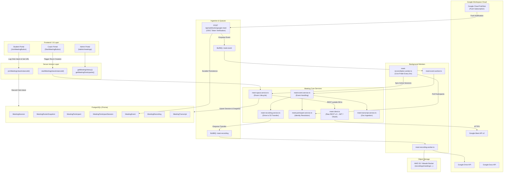

# Google Meet Integration — System Architecture

## 1. Overview
The Strategic Mind Chess (SMC) Google Meet integration provides an automated, resilient, and enterprise-grade video conferencing layer for chess classes. It bridges Google Workspace Meet v2 REST APIs and Cloud Pub/Sub with the SMC PostgreSQL back-office and BullMQ worker pipeline, while strictly isolating meeting telemetry from attendance marking, coach payouts, and penalty calculations.

---

## 2. Architecture Diagram

---

## 3. Core Lifecycle Flow

### 3.1 Room Creation (Coach Click)
1. **Trigger**: Teacher navigates to their dashboard or today's classes and clicks **"Start Meeting"**.
2. **Authorization**:
   - Caller user must be the assigned coach of the `ClassInstance` (or an `ADMIN`).
   - `ClassInstance` must be in `SCHEDULED` status.
3. **Idempotency**:
   - The system checks if an `ACTIVE` or `PENDING` `MeetingSession` already exists for this `classInstanceId`. If found, it returns the existing meeting URL immediately without making external API calls.
4. **Google API Call (Outside Transaction)**:
   - A placeholder `MeetingSession` is staged in `PENDING` status.
   - The system calls `meet-client.ts -> createMeetSpace()`, calling Google Meet REST API v2 (`POST https://meet.googleapis.com/v2/spaces`).
5. **Database Commit**:
   - `MeetingSession` is updated to `ACTIVE` with `googleSpaceId` and `meetingUrl`.
   - `MeetingRosterSnapshot` is written with the batch's enrolled student IDs at that precise moment.
   - A `ClassJoinEvent` is created (`source: START_MEETING_BUTTON`) and `ClassInstance.startedAt` is recorded for backward compatibility with existing coach join logging.

### 3.2 Student Join
1. **Trigger**: Enrolled student clicks **"Join Class"** on their dashboard or batch card.
2. **Access Gating**:
   - Verified that student is enrolled in the batch (`batch.students`).
   - Verified that the class is scheduled for today and within the allowed time window (up to 10 minutes before start time until class end).
3. **Intent Logging**:
   - An entry in `MeetingParticipantSession` is created with `eventSource = "JOIN_BUTTON_CLICK"`.
   - **Crucial Invariant**: This action **NEVER** creates an `AttendanceRecord` or marks the class session complete.

### 3.3 Event Ingestion & Webhook Processing
1. Google Meet publishes conference events to Google Cloud Pub/Sub.
2. Pub/Sub pushes the event via HTTPS POST to `/api/webhooks/google-meet`.
3. If `GOOGLE_PUBSUB_AUDIENCE` is configured, the webhook verifies the Google OIDC Bearer token via Google's public JWKS keys (`https://www.googleapis.com/oauth2/v3/certs`).
4. The raw event is stored durably in the `MeetingEvent` table (`status: PENDING`). If `googleEventId` is already present, it is recognized as a duplicate and immediately acknowledged without re-enqueuing.
5. The event is enqueued onto BullMQ `meet-event` queue with exponential backoff retry.
6. The background worker processes conference lifecycle events:
   - `conference.started` -> marks `MeetingSession.status = ACTIVE`.
   - `conference.ended` -> marks `MeetingSession.status = ENDED`.
   - `participant.joined` / `participant.left` -> resolves participant identity and updates session durations.
   - `recording.fileUploaded` -> creates `MeetingRecording` record and enqueues S3 background transfer.
   - `transcript.fileUploaded` -> creates `MeetingTranscript` record and syncs speech entries.

### 3.4 Fallback Reconciliation
If Google Pub/Sub push notifications are delayed or blocked by network interruptions, the `meet-reconciliation` worker runs every 5 minutes:
- Scans `MeetingSession`s created within the last 4 hours that are still `ACTIVE`.
- Polls Google Meet API v2 for latest participant sessions and conference state.
- Marks inactive sessions as `ENDED` if no participants have been active for >15 minutes after scheduled class end time.

---

## 4. Architectural Invariants & Safety Guarantees

| Invariant | Guarantee |
|---|---|
| **No Auto-Attendance** | Webhook participant sessions and join button clicks never create `AttendanceRecord`s or `ClassLog` entries. Attendance marking remains strictly in the manual coach workflow (`submitClassLog`). |
| **No Premature Room Creation** | Rooms are never created during batch scheduling or cron jobs. They are created on-demand only when a teacher clicks "Start Meeting". |
| **Transaction Isolation** | Google REST API calls are kept strictly outside Prisma `$transaction` blocks to prevent transaction timeouts and database connection pool starvation. |
| **Idempotency** | Webhook events deduplicated by `googleEventId`. Meeting room creation deduplicated by unique `classInstanceId`. |
| **Independent Overlay** | No existing tables (`AttendanceRecord`, `ClassLog`, `Penalty`, `Payout`) were modified. No existing business logic was touched. |

