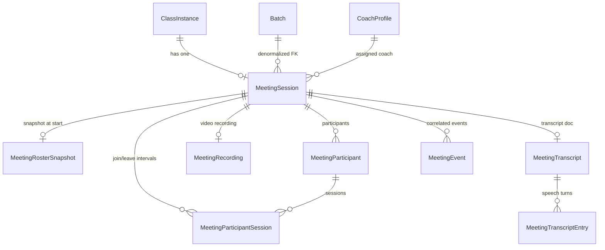

# Google Meet Integration — Database Design & Schema Specification

## 1. Schema Overview

The meeting subsystem is completely contained in `prisma/schema/meeting.prisma`, accompanied by strict foreign key relationships linked to `Batch`, `ClassInstance`, and `CoachProfile`. It provides durable event sourcing, fine-grained telemetry, and historical archiving without altering existing core schemas.

---

## 2. Entity-Relationship Diagram

---

## 3. Model Specifications

### 3.1 `MeetingSession`
Represents an individual Google Meet room instance attached to a scheduled class session.
- `id` (String, cuid, Primary Key)
- `classInstanceId` (String, Unique FK → `ClassInstance.id`, `onDelete: Cascade`)
- `batchId` (String, FK → `Batch.id`, `onDelete: Cascade`) — Denormalized for high-performance dashboard filtering
- `coachProfileId` (String, FK → `CoachProfile.id`)
- `googleSpaceId` (String, Unique) — Google Meet resource identifier (e.g. `spaces/abc123xyz`)
- `meetingUrl` (String) — Direct browser URL (`https://meet.google.com/xxx-yyyy-zzz`)
- `conferenceId` (String?, Nullable) — Google conference record resource ID
- `status` (`MeetingSessionStatus`: `PENDING`, `ACTIVE`, `ENDED`, `FAILED`)
- `createdAt` (DateTime, default `now()`)
- `startedAt` (DateTime?, Nullable)
- `endedAt` (DateTime?, Nullable)
- `lastSyncedAt` (DateTime?, Nullable)
- **Indexes**: `@@index([classInstanceId])`, `@@index([batchId])`, `@@index([status])`, `@@index([coachProfileId])`

### 3.2 `MeetingRosterSnapshot`
Captures the enrolled students at the exact moment the room was instantiated to prevent roster drift during historical audits.
- `id` (String, cuid, Primary Key)
- `meetingSessionId` (String, Unique FK → `MeetingSession.id`, `onDelete: Cascade`)
- `coachProfileId` (String)
- `enrolledStudentIds` (Json) — Array of `StudentProfile.id` strings
- `snapshotAt` (DateTime, default `now()`)

### 3.3 `MeetingParticipant`
Unique participant entity observed in the Google Meet conference.
- `id` (String, cuid, Primary Key)
- `meetingSessionId` (String, FK → `MeetingSession.id`, `onDelete: Cascade`)
- `googleParticipantId` (String) — Google Meet participant resource identifier
- `displayName` (String?, Nullable)
- `email` (String?, Nullable)
- `userProfileId` (String?, Nullable FK → `User.id`)
- `studentProfileId` (String?, Nullable FK → `StudentProfile.id`)
- `coachProfileId` (String?, Nullable FK → `CoachProfile.id`)
- `identityStatus` (`MeetingIdentityStatus`: `MATCHED`, `UNMATCHED`, `AMBIGUOUS`)
- `rawPayload` (Json?, Nullable) — Full audit payload from Google API
- **Constraints & Indexes**: `@@unique([meetingSessionId, googleParticipantId])`, `@@index([meetingSessionId])`, `@@index([userProfileId])`

### 3.4 `MeetingParticipantSession`
Granular join/leave intervals for each participant, accounting for reconnections.
- `id` (String, cuid, Primary Key)
- `participantId` (String, FK → `MeetingParticipant.id`, `onDelete: Cascade`)
- `meetingSessionId` (String, FK → `MeetingSession.id`, `onDelete: Cascade`)
- `joinedAt` (DateTime)
- `leftAt` (DateTime?, Nullable)
- `durationSeconds` (Int?, Nullable) — Automatically calculated as `leftAt - joinedAt`
- `eventSource` (String?, Nullable) — e.g. `PUBSUB`, `API_POLL`, `JOIN_BUTTON_CLICK`
- **Indexes**: `@@index([meetingSessionId])`, `@@index([participantId])`, `@@index([joinedAt])`

### 3.5 `MeetingEvent`
Append-only event store for incoming Google Pub/Sub push messages ensuring zero data loss and strict idempotency.
- `id` (String, cuid, Primary Key)
- `googleEventId` (String, Unique) — Pub/Sub `messageId`
- `meetingSessionId` (String?, Nullable) — Correlated session ID
- `eventType` (String) — E.g. `google.workspace.meet.conference.v1.started`
- `payload` (Json) — Decoded raw message payload
- `receivedAt` (DateTime, default `now()`)
- `processedAt` (DateTime?, Nullable)
- `status` (`MeetingEventStatus`: `PENDING`, `PROCESSING`, `PROCESSED`, `FAILED`, `DEAD_LETTER`)
- `retryCount` (Int, default `0`)
- `errorMessage` (String?, Nullable)
- **Indexes**: `@@index([status, receivedAt])`, `@@index([meetingSessionId])`

### 3.6 `MeetingRecording`
Tracks cloud recording asset lifecycle from Google Drive through S3 archival.
- `id` (String, cuid, Primary Key)
- `meetingSessionId` (String, Unique FK → `MeetingSession.id`, `onDelete: Cascade`)
- `googleDriveFileId` (String)
- `googleDriveUrl` (String?, Nullable)
- `mimeType` (String?, Nullable)
- `sizeBytes` (BigInt?, Nullable)
- `s3Key` (String?, Nullable)
- `transferStatus` (`MeetingTransferStatus`: `PENDING`, `TRANSFERRING`, `COMPLETED`, `FAILED`)
- `transferError` (String?, Nullable)
- `createdAt` (DateTime, default `now()`)

### 3.7 `MeetingTranscript` & `MeetingTranscriptEntry`
Stores speech-to-text transcripts generated during classes for pedagogical review.
- `MeetingTranscript`:
  - `id` (String, cuid, Primary Key)
  - `meetingSessionId` (String, Unique FK → `MeetingSession.id`, `onDelete: Cascade`)
  - `googleDocId` (String?, Nullable)
  - `status` (`MeetingTranscriptStatus`: `PENDING`, `AVAILABLE`, `FAILED`)
  - `processingError` (String?, Nullable)
  - `createdAt` (DateTime, default `now()`)
- `MeetingTranscriptEntry`:
  - `id` (String, cuid, Primary Key)
  - `transcriptId` (String, FK → `MeetingTranscript.id`, `onDelete: Cascade`)
  - `participantId` (String?, Nullable)
  - `speakerName` (String?, Nullable)
  - `text` (String, `@db.Text`)
  - `startOffsetMs` (Int?, Nullable)
  - `endOffsetMs` (Int?, Nullable)
  - **Indexes**: `@@index([transcriptId])`

---

## 4. DDL & Migration
The full DDL is committed in:
`prisma/migrations/new_meeting_tables.sql`

To deploy to production databases, execute the script via standard SQL management tools (e.g. `psql`, pgAdmin, or Railway Query Console). No destructive operations or drops are performed.

