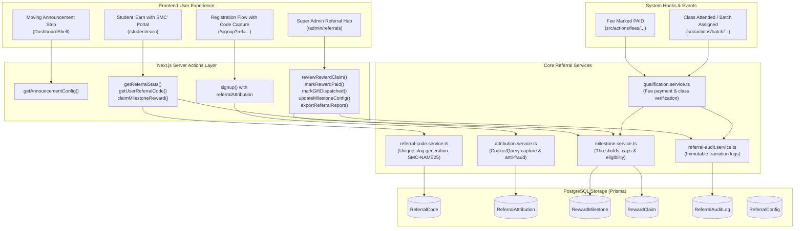
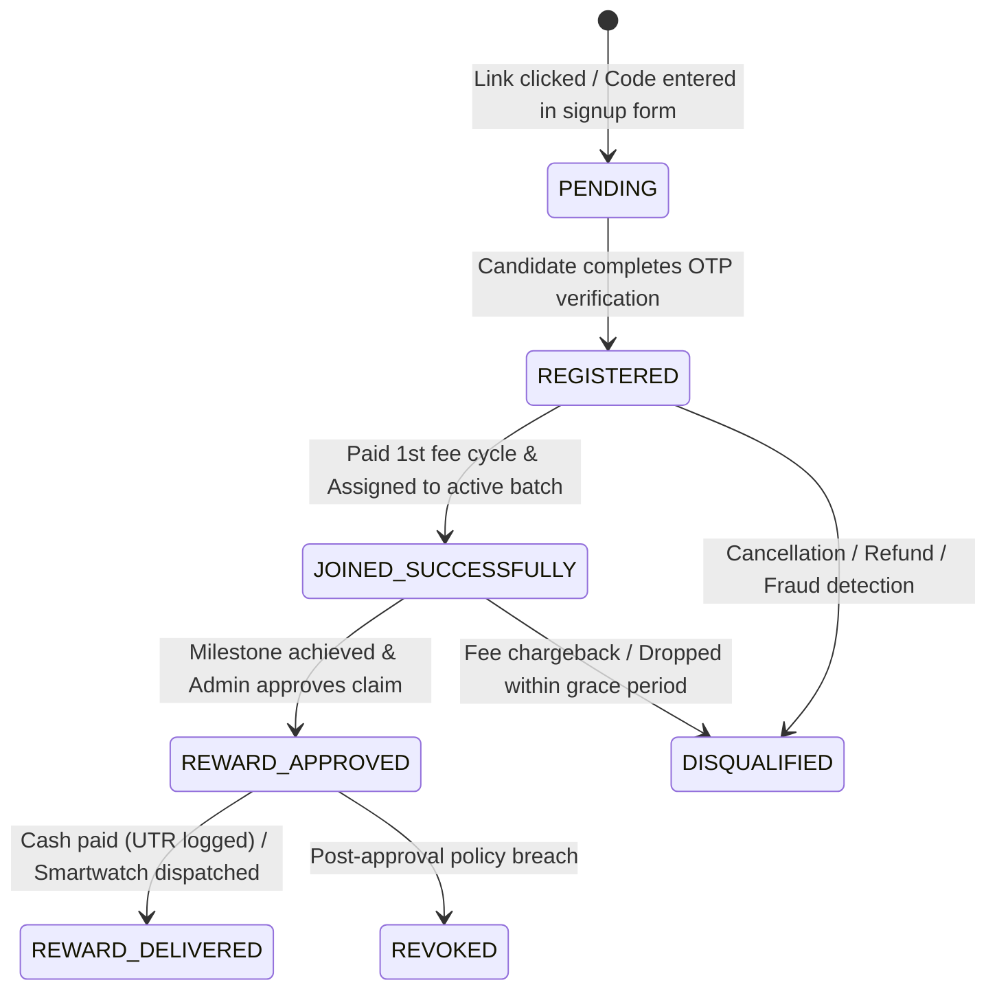

# Strategic Mind Chess (SMC) — Referral & Rewards Program
## Technical Architecture & System Design

---

## 1. Architectural Blueprint

The Referral Program architecture follows a decoupled, event-aware, server-action-driven model integrated cleanly into Next.js 16 (App Router) and PostgreSQL (Prisma ORM).



---

## 2. Frontend Component Architecture

### 2.1 Announcement Strip (`AnnouncementStrip.tsx`)
* **Placement**: Positioned inside `src/components/layout/dashboard-shell.tsx` directly underneath the `Topbar` component, guaranteeing unified visibility across all roles (Admin, Teacher/Coach, Student).
* **Marquee Mechanics**:
  * Utilizes twin-track flex horizontal translation (`@keyframes marquee { 0% { transform: translateX(0%); } 100% { transform: translateX(-50%); } }`).
  * Pure CSS animation prevents JS main-thread blocking and layout thrashing.
  * Interactive pause: Uses `hover:[animation-play-state:paused]` and `focus-within:[animation-play-state:paused]`.
  * Accessibility: Respects `motion-reduce:animate-none` for users with vestibular or motion sensitivity.
* **Palette**: Background `#A94D0B` (Dark Saffron), text bold white `#FFFFFF`, with high-contrast badge accents.
* **CTA Button**: Directly links to the role-appropriate referral hub (`/student/earn` for students, `/admin/referrals` for admin, modal for coaches).

### 2.2 Student "Earn with SMC" Page (`/student/earn`)
Organized under `src/components/referral/`:
1. **`ReferralHeroCard`**:
   * Displays permanent unique code (e.g., `SMC-NAMAN25`).
   * "Copy Code" button with animated checkmark feedback.
   * "Copy Shareable Link" button (`https://smc.academy/signup?ref=SMC-NAMAN25`).
   * "Share" button invoking the native `navigator.share()` API with custom fallback for WhatsApp and email.
2. **`ReferralMetricsSummary`**:
   * Metric Cards: Total Invites, Joined Students, Pending Verification, Total Earned / Dispatched.
3. **`MilestoneProgressBar`**:
   * Visual multi-tier progress tracker (1 Student $\rightarrow$ 3 Students $\rightarrow$ 5 Students).
   * Displays earned rewards, current progress (e.g. 2 of 3 towards Smartwatch), and remaining count to unlock the next tier.
4. **`ReferralHistoryTable`**:
   * Masked student display name (e.g., "Arjun K***").
   * Date registered, current lifecycle status (`PENDING`, `REGISTERED`, `JOINED_SUCCESSFULLY`, etc.).
5. **`RewardsHistoryTable`**:
   * Shows claim status, approved amount, physical gift status, tracking number, and payout dates.
6. **`ProgramTermsModal`**:
   * Slide-out modal detailing rules, payout timelines, and anti-fraud conditions.

### 2.3 Super Admin Referral Hub (`/admin/referrals`)
Organized under `src/components/admin/referrals/`:
1. **`AdminReferralTable`**:
   * Global search by code, referrer email/name, candidate email/name.
   * Filter tabs by status (`ALL`, `PENDING_QUALIFICATION`, `READY_FOR_APPROVAL`, `APPROVED`, `DELIVERED`, `DISQUALIFIED`).
2. **`ClaimReviewDialog`**:
   * Approves or rejects claims with mandatory notes.
   * Allows overriding the final approved cash amount (up to the maximum milestone ceiling).
3. **`FulfilmentDialog`**:
   * For cash: Logs payout method, date, and UTR/Transaction ID.
   * For physical gifts: Logs courier provider (BlueDart, DTDC, etc.), dispatch date, and tracking number.
4. **`MilestoneConfigDrawer`**:
   * Form to adjust milestone thresholds, cash reward caps, gift titles, and cumulative vs. tiered rules.
5. **`ExportReportButton`**:
   * Generates clean CSV export containing audit-ready referral and financial logs.

---

## 3. Server Actions & Service Layer

All backend operations are located in `src/actions/referral/` and `src/services/referral/`:

```
src/
├── actions/
│   └── referral/
│       ├── get-referral-dashboard.ts
│       ├── generate-user-code.ts
│       ├── validate-referral-code.ts
│       ├── admin-manage-claims.ts
│       ├── admin-manage-milestones.ts
│       └── export-referrals.ts
├── services/
│   └── referral/
│       ├── referral-code.service.ts
│       ├── attribution.service.ts
│       ├── qualification.service.ts
│       ├── milestone.service.ts
│       └── referral-audit.service.ts
```

---

## 4. Lifecycle State Machine

The referral lifecycle enforces explicit transitions with state validation and immutable logging:



---

## 5. Security & Anti-Fraud Architecture

1. **Attribution Lock**:
   Once a user registers with a referral code, the relation `ReferralAttribution` is persisted with a `@unique` constraint on `referredUserId`. No user can be referred twice.
2. **Self-Referral Prevention**:
   Strict validation ensures:
   * `referrerId !== candidateUserId`
   * Candidate's signup email cannot belong to an existing user with the same phone number or IP cluster.
3. **Qualification Gatekeeper**:
   A referral is marked `JOINED_SUCCESSFULLY` **only** when both:
   * The student's `FeeCycle.status === 'PAID'` (or explicitly marked as qualified by Admin).
   * The student profile has an active batch enrollment (`BatchStudent`).
4. **Disqualification & Clawback Hooks**:
   When an admin waives fees due to a dispute or issues a refund, an automated reconciliation job evaluates whether the referrer's active milestone claim is impacted, preventing unearned reward fulfillment.

