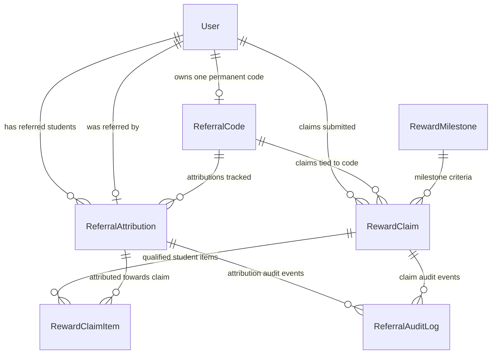

# Strategic Mind Chess (SMC) — Referral & Rewards Program
## Database Design & Prisma Schema Specification (Final Approved)

---

## 1. Schema Overview

The referral subsystem is fully specified in `prisma/schema/referral.prisma`, maintaining clean relational integration with `User` and `StudentProfile` without breaking existing schemas.

---

## 2. Entity-Relationship Diagram



---

## 3. Prisma Schema Definition (`prisma/schema/referral.prisma`)

```prisma
/// Permanent unique referral code assigned to an eligible Student account
model ReferralCode {
  id           String                 @id @default(cuid())
  userId       String                 @unique
  user         User                   @relation("UserReferralCode", fields: [userId], references: [id], onDelete: Cascade)
  code         String                 @unique /// e.g. SMC-NAMAN25
  isActive     Boolean                @default(true)
  clickCount   Int                    @default(0)
  createdAt    DateTime               @default(now())
  updatedAt    DateTime               @updatedAt
  attributions ReferralAttribution[]
  rewardClaims RewardClaim[]

  @@index([code])
  @@index([userId])
  @@map("referral_codes")
}

/// An attributed referral record tracking a prospect from lead to qualification
model ReferralAttribution {
  id                     String             @id @default(cuid())
  referrerId             String
  referrer               User               @relation("UserReferralsSent", fields: [referrerId], references: [id], onDelete: Cascade)
  
  referredUserId         String?            @unique
  referredUser           User?              @relation("UserReferralReceived", fields: [referredUserId], references: [id], onDelete: SetNull)
  
  referralCodeId         String
  referralCode           ReferralCode       @relation(fields: [referralCodeId], references: [id], onDelete: Cascade)
  referralCodeSnapshot   String             /// Immutable historical snapshot of code string
  
  status                 ReferralStatus     @default(PENDING)
  
  /// Prospect information captured at intent / registration
  candidateName          String?
  candidateEmail         String?
  candidatePhone         String?
  
  /// Qualification timestamps
  registeredAt           DateTime?
  joinedAt               DateTime?
  qualifiedAt            DateTime?
  disqualifiedAt         DateTime?
  disqualificationReason String?
  
  /// Network / fraud telemetry
  ipAddress              String?
  userAgent              String?
  
  createdAt              DateTime           @default(now())
  updatedAt              DateTime           @updatedAt
  
  claimItems             RewardClaimItem[]
  auditLogs              ReferralAuditLog[]

  @@index([referrerId])
  @@index([status])
  @@index([referralCodeId])
  @@index([candidateEmail])
  @@map("referral_attributions")
}

/// Configurable reward milestones defined by Super Admin
model RewardMilestone {
  id                 String         @id @default(cuid())
  milestoneOrder     Int            @unique /// 1 = Tier 1 (1 student), 2 = Tier 2 (3 students), 3 = Tier 3 (5 students)
  requiredReferrals  Int            /// 1, 3, 5
  title              String         /// "1 Chessmate", "3 Chessmates", "5 Chessmates"
  rewardType         RewardType     @default(CASH) /// CASH, PHYSICAL_GIFT, HYBRID
  maxCashAmount      Int            @default(0)    /// 500, 5000
  giftDescription    String?        /// "Smartwatch worth up to ₹2,500"
  isCumulative       Boolean        @default(true) /// Cumulative progression: students keep earlier tier rewards
  isActive           Boolean        @default(true)
  createdAt          DateTime       @default(now())
  updatedAt          DateTime       @updatedAt
  claims             RewardClaim[]

  @@map("reward_milestones")
}

/// Reward claim submitted by student upon reaching milestone threshold
model RewardClaim {
  id                    String            @id @default(cuid())
  userId                String
  user                  User              @relation("UserRewardClaims", fields: [userId], references: [id], onDelete: Cascade)
  
  milestoneId           String
  milestone             RewardMilestone   @relation(fields: [milestoneId], references: [id])
  
  referralCodeId        String
  referralCode          ReferralCode      @relation(fields: [referralCodeId], references: [id])
  
  status                RewardClaimStatus @default(PENDING)
  
  /// Student-submitted payout information for cash rewards
  payoutUpiId           String?
  payoutBankDetails     Json?             /// { accountNumber, ifsc, accountHolderName, bankName }
  
  /// Student-submitted physical delivery details for smartwatch rewards
  shippingFullName      String?
  shippingPhone         String?
  shippingAddressLine   String?
  shippingCity          String?
  shippingState         String?
  shippingPincode       String?
  
  /// Admin approval & discretionary amount
  approvedCashAmount    Int?              /// Final approved cash amount (up to ceiling)
  giftItem              String?
  approvedByAdminId     String?
  approvalNotes         String?
  rejectedReason        String?
  
  /// Cash fulfilment tracking
  paymentReference      String?           /// Bank UTR / IMPS / Transaction Reference
  paidAt                DateTime?
  
  /// Physical gift fulfilment tracking
  deliveryCourier       String?           /// Courier name (e.g. BlueDart, DTDC, Delhivery)
  deliveryTrackingNumber String?          /// Tracking Number / AWB
  dispatchedAt          DateTime?
  deliveredAt           DateTime?
  
  createdAt             DateTime          @default(now())
  updatedAt             DateTime          @updatedAt
  
  claimItems            RewardClaimItem[]
  auditLogs             ReferralAuditLog[]

  @@index([userId])
  @@index([status])
  @@index([milestoneId])
  @@map("reward_claims")
}

/// Junction table associating qualified referrals with a specific claim
model RewardClaimItem {
  id            String              @id @default(cuid())
  rewardClaimId String
  rewardClaim   RewardClaim         @relation(fields: [rewardClaimId], references: [id], onDelete: Cascade)
  attributionId String
  attribution   ReferralAttribution @relation(fields: [attributionId], references: [id], onDelete: Cascade)
  createdAt     DateTime            @default(now())

  @@unique([rewardClaimId, attributionId])
  @@map("reward_claim_items")
}

/// Immutable audit log for status transitions and admin actions
model ReferralAuditLog {
  id            String               @id @default(cuid())
  attributionId String?
  attribution   ReferralAttribution? @relation(fields: [attributionId], references: [id], onDelete: Cascade)
  claimId       String?
  claim         RewardClaim?         @relation(fields: [claimId], references: [id], onDelete: Cascade)
  actorId       String?              /// Admin User ID or "SYSTEM"
  action        String               /// STATUS_CHANGE, CLAIM_SUBMITTED, CLAIM_APPROVED, CLAIM_REJECTED, CASH_PAID, GIFT_DISPATCHED, CLAWBACK
  previousState String?
  newState      String?
  reason        String?
  metadata      Json?
  createdAt     DateTime             @default(now())

  @@index([attributionId])
  @@index([claimId])
  @@index([createdAt])
  @@map("referral_audit_logs")
}

/// Program-wide configuration settings
model ReferralConfig {
  id                         String    @id @default("default")
  programActive              Boolean   @default(true)
  campaignStartDate          DateTime?
  campaignEndDate            DateTime?
  minPaidFeeCycles           Int       @default(1)
  allowSelfReferral          Boolean   @default(false)
  requireManualAdminApproval Boolean   @default(true)
  announcementStripText      String    @default("🎁 EARN WITH SMC | Refer 1 Chessmate – Get up to ₹500 cash reward | Refer 3 Chessmates – Get a smartwatch worth up to ₹2,500 | Refer 5 Chessmates – Get a smartwatch + cash reward up to ₹5,000.")
  programTermsMarkdown       String?   @db.Text
  updatedAt                  DateTime  @updatedAt

  @@map("referral_configs")
}

enum ReferralStatus {
  PENDING
  REGISTERED
  JOINED_SUCCESSFULLY
  REWARD_APPROVED
  REWARD_DELIVERED
  DISQUALIFIED
}

enum RewardType {
  CASH
  PHYSICAL_GIFT
  HYBRID
}

enum RewardClaimStatus {
  PENDING
  APPROVED
  REJECTED
  PAID
  DISPATCHED
  DELIVERED
}
```

---

## 4. Updates to `prisma/schema/user.prisma`

The `User` model in `prisma/schema/user.prisma` will be extended with:

```prisma
  // Referral Program Relations
  referralCode          ReferralCode?          @relation("UserReferralCode")
  referralsSent         ReferralAttribution[]  @relation("UserReferralsSent")
  referralReceived      ReferralAttribution?   @relation("UserReferralReceived")
  rewardClaims          RewardClaim[]          @relation("UserRewardClaims")
```
