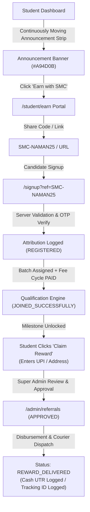

# Strategic Mind Chess (SMC) — Referral & Rewards Program ("Earn with SMC")
## Executive & Functional Overview (Approved Specification)

---

## 1. Executive Summary

The **Earn with SMC** Referral & Rewards Program is tailored for **Students and Parents** of Strategic Mind Chess (SMC) to accelerate organic student onboarding while rewarding active community advocates.

By establishing structured milestone rewards (cash rewards and physical smartwatches) combined with automated attribution, rigorous server-side fraud prevention, payment/batch-based qualification, student payout/shipping claim collection, and centralized Super Admin management, SMC ensures transparent reward fulfillment while maintaining complete financial and operational control.

---

## 2. Core Program Pillars & Confirmed Rules

1. **Target Audience (Eligible Referrers)**:
   * **Students and Parents only**. Coaches, teachers, and admins do not participate as referrers.
2. **Dashboard Announcement Strip**:
   * Displayed strictly on **Student and Parent dashboards** below the top navigation bar.
   * Background dark saffron (`#A94D0B`) with bold white text.
   * Continuous smooth horizontal marquee with hover-pause and `prefers-reduced-motion` compliance.
   * Clickable **"Earn with SMC"** badge routing directly to the dedicated `/student/earn` hub.
3. **Unique Referral Codes & Links**:
   * Auto-generated format: `SMC-<FIRSTNAME><2-DIGIT-RANDOM>` (e.g., `SMC-NAMAN25`, `SMC-ROHAN48`).
   * Permanent unique code and shareable URL (`https://smc.academy/signup?ref=SMC-NAMAN25`).
   * 1-click **Copy Code**, **Copy Link**, and **Share** (Native Web Share API + WhatsApp fallback).
4. **Qualification Checkpoints**:
   * A referral transitions from `REGISTERED` to `JOINED_SUCCESSFULLY` **only when**:
     1. The student's 1st fee cycle is marked **`PAID`** by Admin, **AND**
     2. The student is officially enrolled in an active **Batch**.
5. **Cumulative Milestone Rewards**:
   * **1 Student**: Cash reward **up to ₹500** (Bank Transfer / UPI).
   * **3 Students**: Smartwatch **worth up to ₹2,500** (Physical courier delivery).
   * **5 Students**: Smartwatch + cash reward **up to ₹5,000** (Smartwatch shipped + Bank Transfer / UPI).
   * Rewards are **cumulative** — students keep and unlock each tier progressively as their count grows.
6. **Claim & Fulfillment Workflow**:
   * When a milestone is reached, the student clicks **"Claim Reward"** on `/student/earn`.
   * For cash rewards: Student enters **UPI ID** or **Bank Account Details**.
   * For smartwatch rewards: Student enters their **Full Shipping Address & Contact Number**.
   * Super Admin reviews and enters the approved cash amount (defaulting to max cap, adjustable).
   * For cash: Admin logs transaction UTR upon payment.
   * For smartwatch: SMC Operations team dispatches via courier and logs **Courier Name & Tracking Number** in Admin Hub.
7. **Privacy & Data Protection**:
   * On the student's referral history table, referred student identities are masked for privacy (e.g., `Aarav S*****` / `a***@gmail.com`).
8. **Refund & Cancellation Clawback**:
   * If a referred student cancels or receives a fee refund within the grace period (14–30 days), the referral is marked `DISQUALIFIED`, 1 is deducted from the qualified count, and any unfulfilled claim is frozen/revoked.

---

## 3. High-Level Lifecycle Flow

