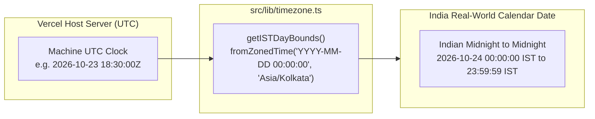
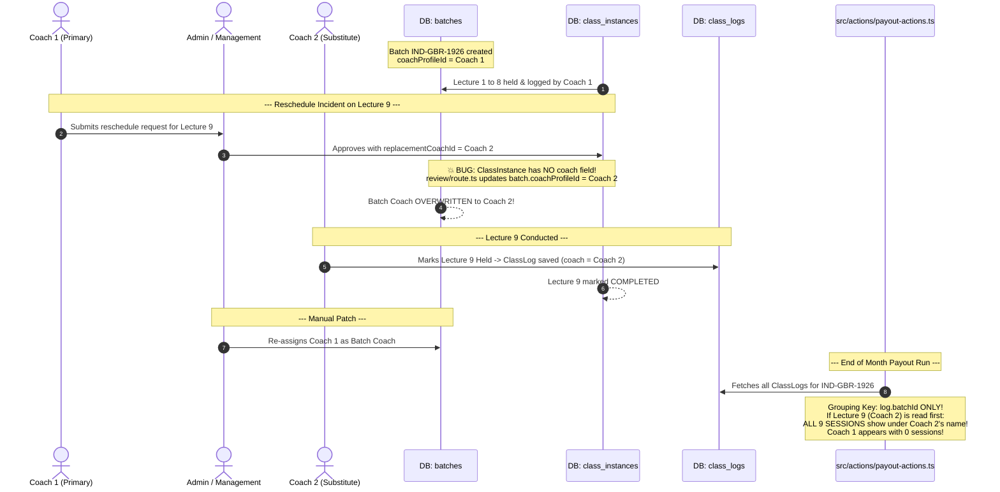
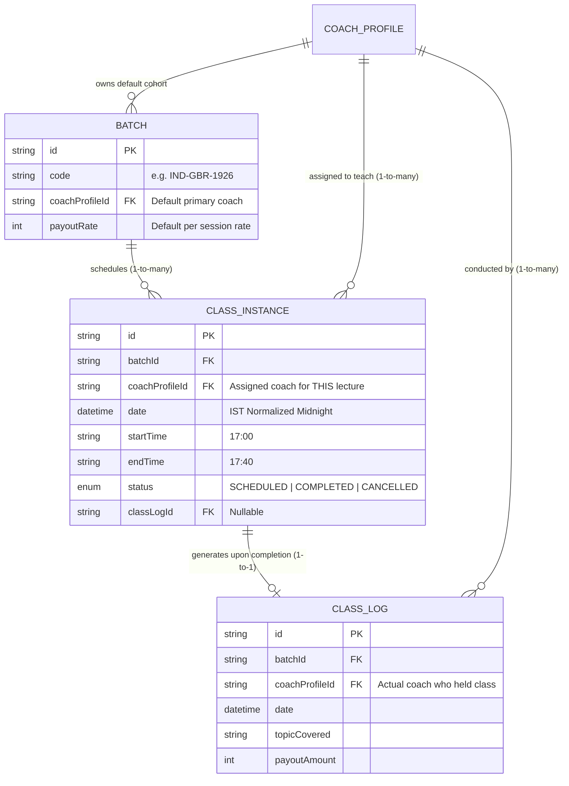
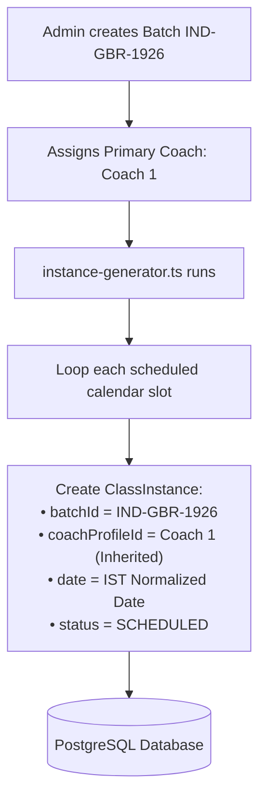
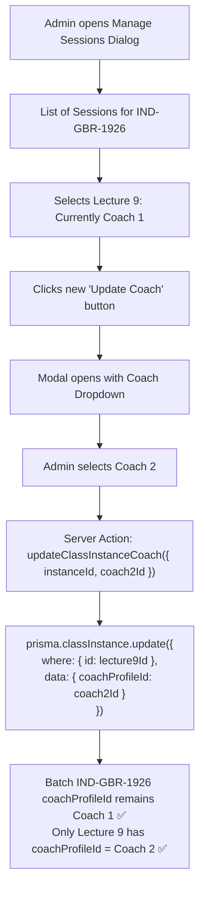
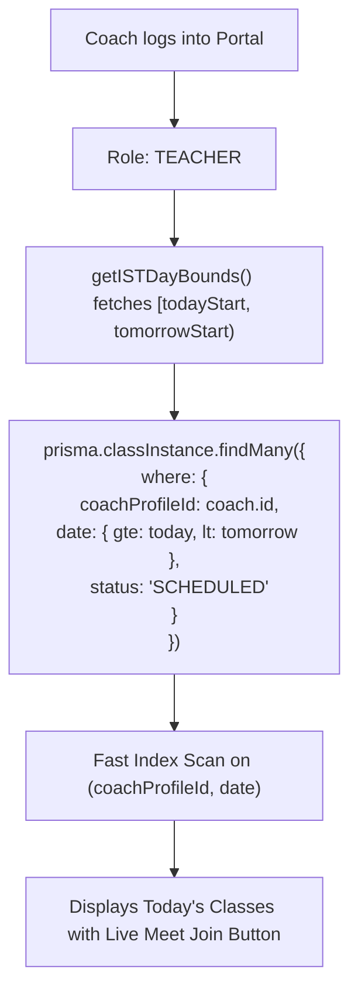
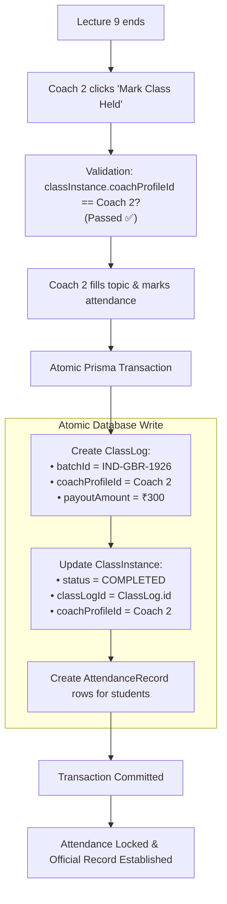
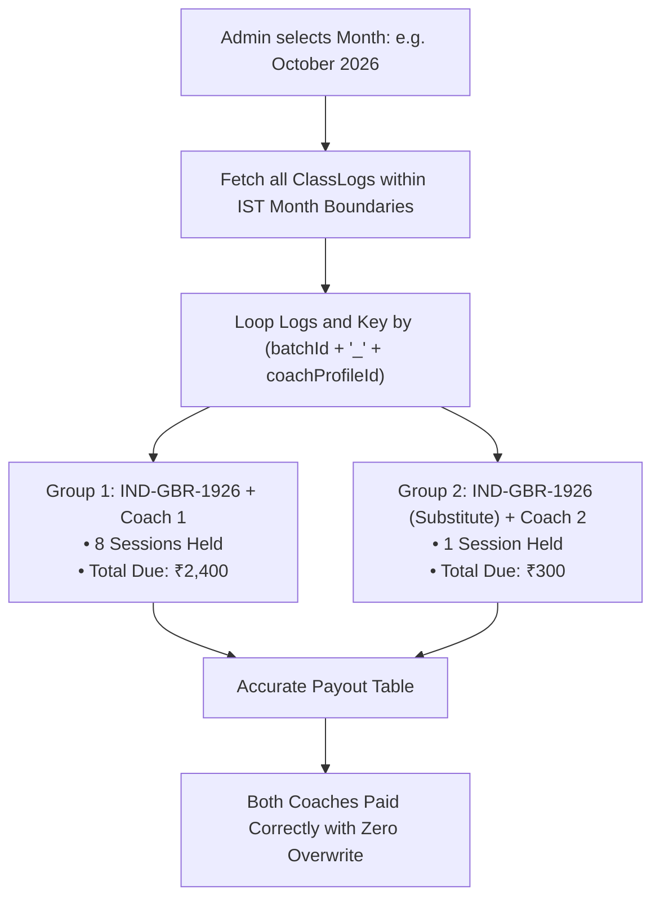
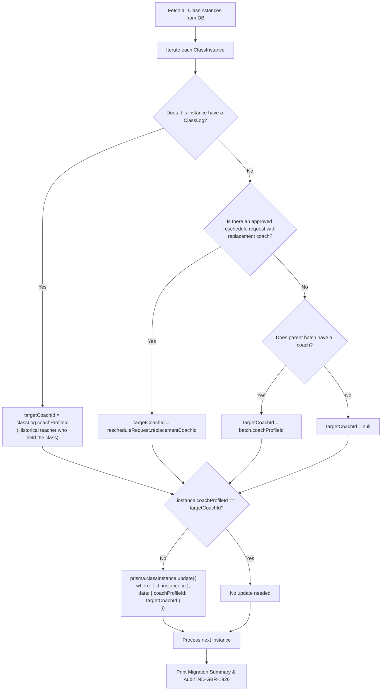

# Complete Flow & Architectural Blueprint: ClassInstance Coach Decoupling

**Document Type:** Technical Architecture & System Flow Specification  
**Status:** Under Review (Zero Code Changes Applied Yet)  
**Target Batches:** All Active Production Batches (e.g. `IND-GBR-1926`)  
**Timezone Context:** Host Server = US/UTC (Vercel) | Real Users = India (Asia/Kolkata, UTC +5:30)

---

## 1. Executive Summary

In Strategic Mind Chess CRM, **Batches** represent the permanent long-term cohort (e.g., *Core 2 Bridge*), while **ClassInstances** represent individual scheduled lectures (e.g., *Lecture 1*, *Lecture 2*, ..., *Lecture 9*).

### The Core Problem in Production Today
- Currently, individual `ClassInstance` records **do not store a coach ID**. They inherit the coach solely through `batch.coachProfileId`.
- When an individual lecture needs a substitute or replacement coach (e.g. Lecture 9 assigned to Coach 2), the system currently updates `batch.coachProfileId`.
- **Result:** Overwriting the batch coach reassigns the **entire cohort** to the substitute coach, corrupts the audit trail, collides in teacher dashboards, blocks attendance marking, and breaks monthly payout calculations.

### The Solution
1. **Decouple Coach Assignment:** Add `coachProfileId` directly to `ClassInstance`.
2. **"Update Coach" on Session Management:** In the Admin "Manage Sessions" modal, provide an **"Update Coach"** button for each lecture that updates **only that specific instance**.
3. **Strict Integrity:** The parent `Batch.coachProfileId` remains unchanged.
4. **Attendance & Payout Accuracy:** Attendance and payouts match the coach assigned to that specific instance and logged in `ClassLog`.

---

## 2. Timezone Synchronization Architecture (US Server vs. India IST)

Because the Next.js production server runs on Vercel (UTC / US servers), naive JavaScript `new Date()` or `setHours(0,0,0,0)` would cause a **5 hour 30 minute date drift**. 

All queries and background checks MUST strictly utilize `src/lib/timezone.ts`:

### Timezone Storage & Query Rules:
- **Database Storage:** `ClassInstance.date` is stored as normalized UTC timestamp representing Indian midnight (`T18:30:00.000Z` of the prior calendar day).
- **Time Strings:** `startTime` and `endTime` are stored as pure 24-hour strings (e.g. `"17:00"`, `"17:40"`).
- **Date Range Queries:** Queries must always use `date: { gte: today, lt: tomorrow }` where `today` and `tomorrow` come from `getISTDayBounds()`.

---

## 3. As-Is Flow: Current Production Architecture (The Buggy Flow)

Below is the exact flow executing in production today, illustrating why the collision occurs:

---

## 4. To-Be Flow: Decoupled Target Architecture

In the new architecture, **Batch Ownership** and **Class Execution** are cleanly separated.

### Entity Relationship Model:

---

## 5. End-to-End System Workflows (To-Be State)

### Workflow A: Batch Creation & Class Generation
When a new batch or recurring future instances are generated, each instance inherits the default batch coach.

---

### Workflow B: Admin "Update Coach" on Manage Sessions Dialog
This is the new feature requested. Admin can change the coach for any individual lecture without touching the parent batch.

---

### Workflow C: Teacher Dashboard & Today's Attendance Load
Fast, indexed database query using India calendar boundaries:

---

### Workflow D: Attendance Marking & ClassLog Locking
The coach who takes the class marks attendance and becomes the immutable historical coach:

---

### Workflow E: Monthly Coach Payout Aggregation
Payout summary resolves the collision by aggregating per `batchId + "_" + coachProfileId`:

---

## 6. Database Backfill Script Logic (`src/scripts/backfill-class-instance-coaches.ts`)

To ensure zero downtime and zero broken records on the 6–7 live batches, the backfill script executes the following deterministic reconciliation:

---

## 7. Safety & Backward Compatibility Guarantee

1. **Non-Destructive Schema Change:**
   - Adding `coachProfileId` to `class_instances` as nullable/optional does not drop any tables or lock rows.
2. **Fallback Queries:**
   - Any query in application code will use:
     `coachId = classInstance.coachProfileId || classInstance.batch.coachProfileId`
     This ensures that during deployment, not a single page or API throws an error.
3. **No Batch Overwrites:**
   - Updating a class instance never touches `Batch.coachProfileId`.
